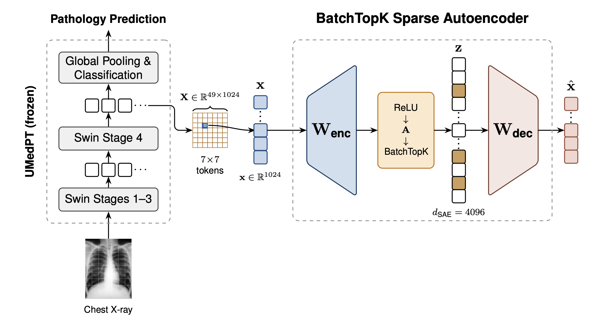

# mechinterp-medical-vision

**Sparse-autoencoder mechanistic interpretability of a medical foundation model.**

Code accompanying the bachelor thesis *Probing Feature Universality in Medical Vision Models*
(Bilal Waraich, Constructor University, May 2026).
**[Read the thesis (PDF)](thesis/Probing_Feature_Universality_in_Medical_Vision_Models_Thesis_BilalWaraich.pdf)**

The pipeline trains a [BatchTopK sparse autoencoder](https://arxiv.org/abs/2412.06410) on activations of
[UMedPT](https://arxiv.org/abs/2311.09847) (a multi-task Swin Transformer for medical imaging) and asks whether the
learned features are *universal*: do they fire, and point in the same direction, across four chest X-ray datasets
from different institutions, populations and label schemes?

<p align="center">
  
</p>

*A chest X-ray is tokenised by the frozen UMedPT Swin backbone into 49 × 1024 Stage 4 patch tokens. Each token is
encoded independently, sparsified to a 4,096-dimensional code, and reconstructed. Sparsity is enforced by BatchTopK
during training (a global top-k·B across the batch) and by per-sample top-k at inference.*

**Headline result (thesis, Section 4):** of 4,096 SAE features, 65 are confirmed universal across CheXpert and RSNA
Pneumonia, and three of those also pass a Bonferroni-corrected spatial test against radiologist bounding boxes. The
same tests confirm 16 components for a PCA baseline and 1,490 for a randomly initialised SAE.

## Pipeline

```
harvest  ->  train  ->  evaluate universality  ->  visualise
```

| Stage | Script |
|---|---|
| Harvest | `src/conglomerate/harvest_all.py` |
| Train | `src/train_sae.py` |
| Scanner audit | `src/scripts/scanner_latent_audit.py` |
| Universality | `src/scripts/universality_eval.py` |
| Null baselines | `src/scripts/null_baseline_eval.py` |
| Clinical analysis | `src/scripts/illness_stratified_eval.py`, `cross_dataset_eval.py`, `inspect_universal_latents.py` |
| Causal check | `src/scripts/run_activation_patching.py` |
| Visualise | `src/visualise.py`, `src/visualisation/` |

Each script documents its arguments in its module docstring and via `--help`. Methodology notes are in
[`docs/`](docs/), starting with [`docs/methodology.md`](docs/methodology.md) and
[`docs/universality_analysis.md`](docs/universality_analysis.md).

## Setup

Python 3.11.

```bash
git clone https://github.com/Bilal-Waraich/mechinterp-medical-vision.git
cd mechinterp-medical-vision
python -m venv .venv && source .venv/bin/activate
pip install -e .
```

`pip install -e .` also installs the UMedPT library (`medicalmultitaskmodeling==1.6.3`). A pip dry-run confirmed that
the full dependency set resolves together on Python 3.11 (torch 2.6, torchvision 0.21, numpy 1.26, wandb 0.23,
sae-lens 6.5).

> **Licence note.** UMedPT / MedicalMultitaskModeling is released by Fraunhofer MEVIS under a
> [non-commercial research licence](https://github.com/FraunhoferMEVIS/MedicalMultitaskModeling/blob/main/license.md)
> that does not allow redistribution. This repository therefore contains **none** of its code or weights: you install
> the library from PyPI and obtain the weights yourself. Accepting that licence is your own responsibility, and the
> scripts here do not accept it on your behalf. Read it, then follow the library's instructions for acknowledging it
> (it reports what is needed when it is first imported).

### Encoder weights

The harvest step loads a pickled UMedPT encoder (`torch.load(..., weights_only=False)`) from `--checkpoint`, for
example `encoder-1.0.4.pt/encoder.pt`. The thesis used the UMedPT encoder at release version 1.0.4. See the
[MedicalMultitaskModeling README](https://github.com/FraunhoferMEVIS/MedicalMultitaskModeling) for how to obtain the
pretrained weights. A checkpoint of this kind is unpickled, so **only load files from sources you trust**.

### Data

Obtain the four datasets from their original sources and follow their terms of use:

| Dataset | Source |
|---|---|
| CheXpert | Irvin et al., AAAI 2019. <https://arxiv.org/abs/1901.07031> |
| RSNA Pneumonia | <https://www.kaggle.com/c/rsna-pneumonia-detection-challenge> |
| SIIM-FISABIO-RSNA COVID-19 | <https://www.kaggle.com/c/siim-covid19-detection> |
| TB Shenzhen | Jaeger et al., 2014. <https://doi.org/10.3978/j.issn.2223-4292.2014.11.20> |

Sampling, filtering and label mapping are described in [`docs/datasets_xray.md`](docs/datasets_xray.md).

### Paths

Two environment variables control where things live (see [`configs/paths.py`](configs/paths.py)):

```bash
export SAE_INPUT_ROOT=/path/to/datasets   # raw datasets and label CSVs (default: ./data)
export SAE_OUTPUT_ROOT=/path/to/outputs   # activations, SAE checkpoints, analysis outputs (default: ./outputs)
```

## Example: harvest, then train

```bash
python src/conglomerate/harvest_all.py \
    --checkpoint encoder-1.0.4.pt/encoder.pt \
    --chexpert_dir   $SAE_INPUT_ROOT/chexpert \
    --rsna_dir       $SAE_INPUT_ROOT/rsna-pneumonia \
    --siim_dir       $SAE_INPUT_ROOT/siim-covid19 \
    --tb_dir         $SAE_INPUT_ROOT/tb-shenzhen \
    --output  data/xray_activations.safetensors \
    --pm_index 2 --device cuda:0

python src/train_sae.py --config configs/sae_pm2.json
```

## Reproducibility status

The original experiments ran on a GPU cluster, with the datasets and weights mounted from internal storage. This
public version replaces those hardcoded locations with the environment variables above and leaves out the cluster
job files and container build files. **It has not yet been re-run end to end outside the original environment.**
What has been checked: the dependency set resolves, all Python files compile, and the model-loading path relies on
only two UMedPT classes (`PyramidEncoder`, `TorchVisionSwinformer`), which are identical between the library version
the experiments ran with and the pinned release. A GPU is needed for harvesting and training. Issues and
reproduction reports are welcome.

## About this repository's history

This repository has two branches:

- **`batch-topk`** (default): the thesis pipeline (BatchTopK SAE).
- **[`Matryoshka`](../../tree/Matryoshka)**: a Matryoshka sparse-autoencoder implementation and its analysis. An earlier
  snapshot that diverged from `batch-topk` before the final thesis changes.

The history was rewritten to
remove large binary files and institution-internal infrastructure details, so commit hashes differ from the original
development repository.

## Licence

The code in this repository is released under the [MIT licence](LICENSE).

This covers only the code written for this project. It does **not** cover:

- **UMedPT / MedicalMultitaskModeling**, which is installed separately and has its own non-commercial research
  licence (see the licence note above).
- **The datasets**, each of which has its own terms of use.
- **The thesis PDF and the figures in `thesis/` and `docs/img/`**, which are © 2026 Bilal Waraich, shared for reading
  and citation.

Because the pipeline depends on UMedPT, any use of the whole pipeline is also bound by UMedPT's licence terms.

## Acknowledgements

Developed in collaboration with [Nikolay Tsonev](https://github.com/Nikolay-Ts), with whom the dataset, activation
harvesting and training parts were worked on together. Thanks to the authors of UMedPT (Fraunhofer MEVIS) and of
BatchTopK SAEs (Bussmann et al.), whose work this builds on.

## References

- Schäfer et al., *Overcoming Data Scarcity in Biomedical Imaging with a Foundational Multi-Task Model*, 2023. arXiv:2311.09847
- Bussmann, Leask, Nanda, *BatchTopK Sparse Autoencoders*, 2024. arXiv:2412.06410
- Gao et al., *Scaling and Evaluating Sparse Autoencoders*, 2024. arXiv:2406.04093
- Elhage et al., *Toy Models of Superposition*, 2022. arXiv:2209.10652
